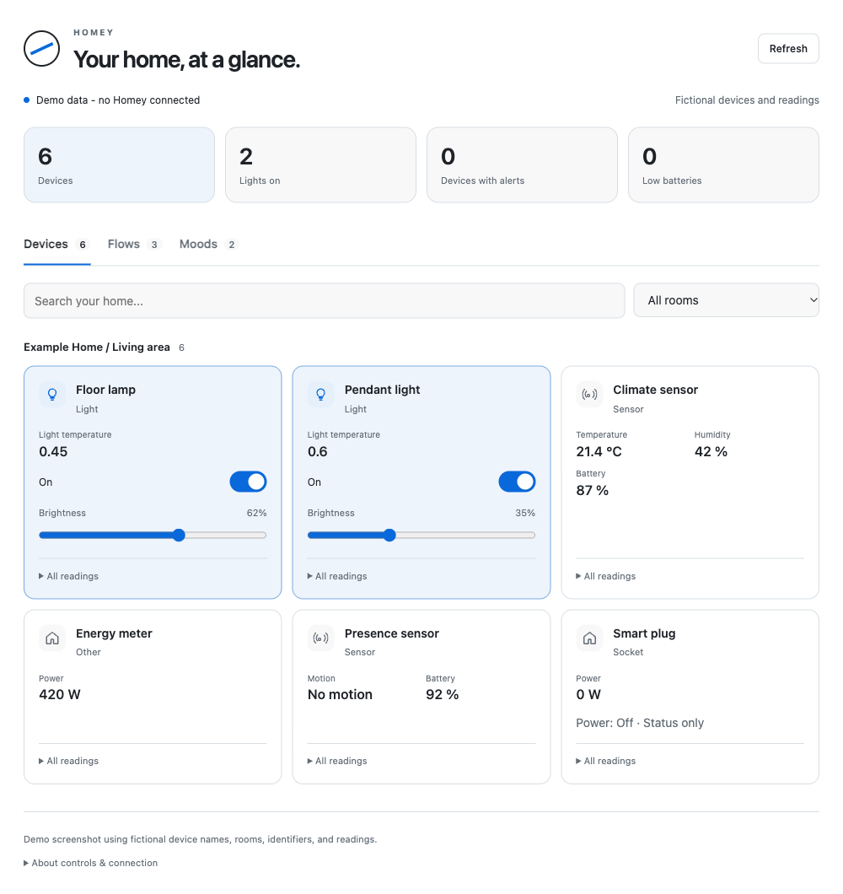

# Homey Dashboard for GitHub Copilot

[Prerequisites](#prerequisites) · [Installation](#installation) · [Using the dashboard](#using-the-dashboard) · [Managing Flows with Copilot chat](#managing-flows-with-copilot-chat) · [FAQ](#faq) · [Troubleshooting](#troubleshooting) · [Local tests](#local-tests) · [License](#license)

A user-scoped canvas for the GitHub Copilot desktop app. It uses Homey's Model Context Protocol (MCP) server to show your devices by room and give you quick access to lights, Flows, and Moods.

- Browse room and device snapshots, including device readings where available.
- Turn supported lights on or off and dim them if they support dimming. Other device types are read-only.
- Start Flows and activate Moods after confirming the action.



*The screenshot uses entirely fictional demo data, not a connected home.*

## Prerequisites

- A GitHub Copilot desktop app build and runtime that support extension canvases and the SDK RPCs this canvas uses to call MCP tools. A Copilot CLI session on its own does not provide the desktop canvas UI.
- A Homey account with access to a Homey that can connect through the Homey MCP service.
- Git to install from this repository. A local Node.js installation is needed only if you want to run the tests yourself.

Copilot supplies the SDK at runtime. There is no `npm install` step.

## Installation

### 1. Install the user-scoped extension

In a shell, clone the repository into Copilot's user extensions directory:

```sh
extensions_dir="${COPILOT_HOME:-$HOME/.copilot}/extensions"
mkdir -p "$extensions_dir" &&
  git clone https://github.com/soderlind/copilot-homey-canvas.git "$extensions_dir/homey-dashboard"
```

If `homey-dashboard` already exists, inspect it first. If it is a clone of this repository, update it only after committing or backing up local changes. If it is a custom installation, keep it as-is or move it to a backup location **outside** the extensions directory before cloning. Do not copy over an existing installation or discard local changes.

### 2. Connect Homey MCP

In the Copilot desktop app, add a user-scoped **HTTP** MCP server under **Customize**, using the name `homey` and URL `https://mcp.athom.com`. If that server is already installed at user scope, reuse it. Homey's [official MCP connection guide](https://support.homey.app/hc/en-us/articles/27950286160540-How-to-connect-Homey-to-ChatGPT) documents the endpoint; its ChatGPT-specific steps are not needed for Copilot.

Go to **Customize > Installed > homey > Sign in** and authorize the connection in Homey's OAuth flow. Copilot handles Homey authentication and native tool permission prompts; the extension does not need a token in its files.

### 3. Reload and open the canvas

Reload extensions in Copilot or quit and reopen the desktop app. In a Copilot conversation, ask: **"Open the Homey dashboard."** The canvas opens alongside the conversation.

## Using the dashboard

The canvas fetches an initial snapshot. Use **Refresh** to fetch an updated view, especially after changes made outside the canvas. The dashboard also checks device status after an accepted command, but it does not stream live Homey updates. Review any Flow or Mood confirmation before proceeding: a Flow or Mood can affect more than what is visible on the dashboard.

The renderer listens only on loopback. The extension keeps device snapshots in memory rather than writing them to disk. Commands are not automatically retried; if one fails or times out, refresh and check the current state before trying again.

## Managing Flows with Copilot chat

Use the Copilot conversation to ask Homey MCP to inspect, create, or update Flows. This chat-based authoring is separate from the canvas's **Run Flow** buttons, which start an existing Flow after confirmation. Available trigger, condition, and action cards depend on the apps and devices installed in your Homey. Ask for suggestions without changes when exploring; creating, updating, enabling, or starting a Flow can have effects, so review the proposed changes and explicitly confirm before Copilot applies them. An enabled Flow runs automatically when its trigger matches.

For example, ask for a read-only plan first:

> Review the available Homey Flow trigger, condition, and action cards. Suggest a disabled Flow for my fictional “Reading corner lamp” that I could run at sunset. Do not create or change anything.

When you are ready to create it, start disabled so you can inspect it before enabling:

> Prepare a standard Flow named “Demo reading light at sunset” for the fictional “Reading corner lamp”. First inspect the available sunset trigger and light action cards and their required arguments. Show me the proposed trigger, conditions, and actions, with `enabled` set to false, and wait for my confirmation before creating it. Do not enable or run it.

Ask for a narrowly scoped edit and tell Copilot to preserve unrelated settings:

> Update only the action in “Demo reading light at sunset” so it sets the fictional “Reading corner lamp” to 40% brightness. Read the current Flow first and preserve its name, enabled state, trigger, conditions, and all other settings. Show me the proposed change and wait for confirmation before updating.

You can reversibly disable an exact Flow instead of deleting it:

> Find the exact Homey Flow named “Demo reading light at sunset”. Show me its current enabled state, then ask for confirmation before updating only `enabled` to false. Preserve every other setting and do not run the Flow.

Homey MCP does not provide a Flow deletion tool, so Copilot cannot directly delete Flows. To remove one, ask for guidance and perform the deletion yourself in Homey's own app; do not treat disabling a Flow as deletion:

> Help me delete the exact Flow named “Demo reading light at sunset” in Homey's app. First help me identify the right Flow and explain what may depend on it. Do not change or disable anything; guide me while I remove it manually.

## FAQ

### Should I open more than one Homey canvas?

For the simplest setup, keep one Homey canvas open and reuse that panel instead of opening duplicates. This is a precaution, not a technical limit or a proven fix for sign-in problems; multiple canvas panels and multiple MCP clients are separate things. If Homey reports an expired access token, sign in again under **Customize > Installed > homey > Sign in**. Opening only one canvas does not itself renew an expired token.

## Troubleshooting

| Symptom | What to check |
| --- | --- |
| Copilot cannot find the canvas | Check that `extension.mjs` is directly inside the `homey-dashboard` directory and that the desktop app/runtime supports extension canvases. Reload extensions or restart the app. A project-scoped extension with the same folder name can shadow the user-scoped one. |
| Homey is disconnected or asks for authentication | Verify the name and URL of the user-scoped MCP server, then sign in again under **Customize > Installed > homey**. If the server or sign-in action is missing, verify that the server was added at user scope and the app supports signing in to remote MCP servers. |
| Data looks stale | Use **Refresh**. If that fails, check your Homey connection and any Copilot permission prompt. |
| A control is missing | Direct controls are available only for lights with the corresponding on/off or dimming capability. Other devices are read-only. |

## Local tests

From the repository root, run:

```sh
node --test homey.test.mjs
```

The tests use fixtures and do not require a live Homey connection.

## License

[MIT](LICENSE)
